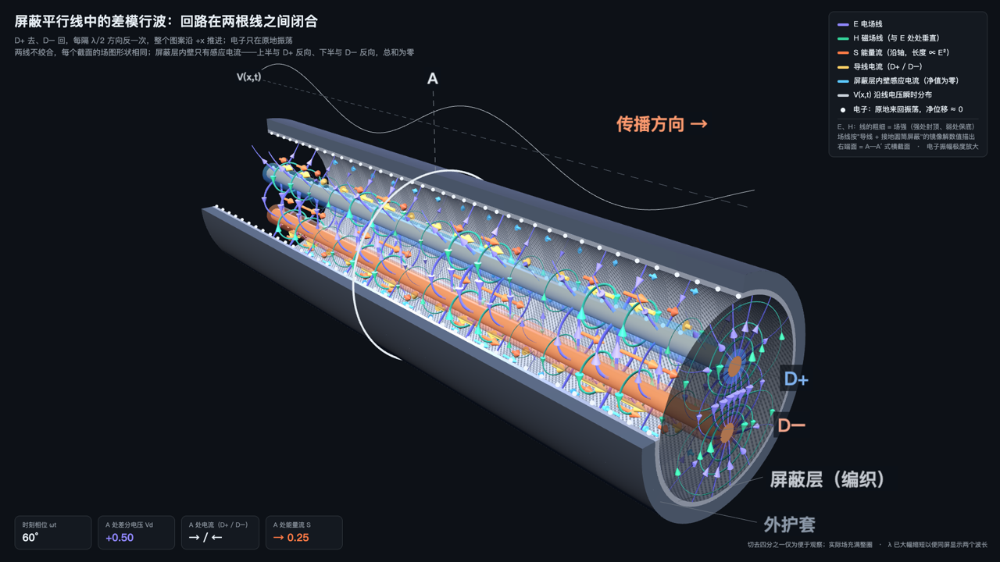

# 屏蔽平行线行波 3D 动画

**差分信号的回路在两根线之间闭合，屏蔽层只有"上半与 D+ 反向、下半与 D− 反向、总和为零"的感应电流；切到共模，屏蔽层才成为回流路径。**

一个可交互的 Three.js 3D 动画：切开一段屏蔽平行线（两根不绞合的导线加一层屏蔽，高速线缆中的 twinax 即此结构），看行波推进时，电场、磁场、能量流、导线电流、屏蔽层电流和电子各自在做什么，并一键对比差模与共模。

同系列：[同轴电缆版](https://github.com/wangbrightly/coax-traveling-wave-3d)　·　[屏蔽双绞线版](https://github.com/wangbrightly/stp-traveling-wave-3d)

### [▶ 在线打开（可拖动旋转、切换差模/共模）](https://wangbrightly.github.io/shielded-pair-traveling-wave-3d/)



视频版（1920×1080，8 秒无缝循环，可直接插入 PPT / WPS）：
[差模](shielded-pair-traveling-wave-3d-dm.mp4)　·　[共模](shielded-pair-traveling-wave-3d-cm.mp4)

---

## 画面里有什么

| 颜色 | 物理量 | 怎么画的 |
|---|---|---|
| 紫 | 电场 E | 按"两根导线 + 接地圆筒屏蔽"的镜像解**数值描出**的电场线；起点按导线表面电荷密度分配，线越密场越强；线的粗细也表示场强 |
| 绿 | 磁场 H | 理想 TEM 行波里 H ∥ x̂ × E，所以 H 线就是电位的等高线，与 E 处处垂直 |
| 橙 | 能量流 S = E × H | 长度 ∝ E²，始终指向 +x |
| 黄 | 导线电流 | 沿导线方向；差模 D+ 与 D− 反向，共模同向 |
| 青 | 屏蔽层内壁电流 | 由内壁的法向电场算出（K = n̂ × H）；差模时正负两半抵消，共模时整体反向回流 |
| 白点 | 电子 | 在平衡位置附近来回振荡，净位移 ≈ 0 |
| 白线 | V(x,t) | 沿线电压瞬时分布（差模为 Vd，共模为 Vc） |

右端面就是一个完整的横截面（相当于原 2D 版的 A—A′ 截面），场图画得最全。

## 动画想讲清楚的几件事

1. **差模的回路在两根线之间闭合**：D+ 去、D− 回。场大部分被约束在两线之间，两根线的磁场在远处大部分抵消。
2. **屏蔽层在差模下并非"没有电流"**：内壁有感应电流，靠近 D+ 的一侧与 D+ 反向，靠近 D− 的一侧与 D− 反向，总和为零（由高斯定律保证：屏蔽层包围的总电荷 +1 −1 = 0）。一部分电场线也终止在屏蔽层上。
3. **共模时屏蔽层才是回流路径**：两根线同向流动，电场从两根线指向屏蔽层，两线中点场强为零。共模电流正是屏蔽端接与 EMI 问题的源头。
4. **不绞合，所以每个截面的场图形状完全相同**：D+ 在上、D− 在下。屏蔽层电流的分布也因此固定——上半部与 D+ 反向、下半部与 D− 反向；正前方切口恰在两线的中垂面上，差模时那里法向电场为零，所以那一排电子在差模下几乎不动（只偏离中垂面 0.03 弧度，残余摆幅约为顶部切口的 2%）。
5. **电子几乎不动**：速度 ∝ −I，位移 ξ = ∓A·sin(ωt − kx)，只在原地振荡；真正向前跑的是场的图案。

## 示意上的取舍

- 切去四分之一屏蔽层与护套只是为了看清内部；场实际充满整圈。
- 波长被大幅缩短，以便同屏显示两个波长。
- 场图用的是二维静态镜像解（细线电荷近似、介质均匀、准 TEM），没有考虑导线粗细带来的邻近效应、损耗，以及实际 twinax 里常见的排流线（drain wire）。
- 共模与差模假设传播速度相同；实际线缆中绝缘层与空气的介质分布不均匀，两者速度略有差别，这正是模式转换与对内时延差的来源之一。
- 电子振幅被极度放大；真实振幅远小于原子尺寸。

## 使用

- **在线看**：打开上面的链接。可以拖动旋转、暂停、拖动相位滑块，或切换差模/共模；网址末尾加 `#cm` 直接打开共模。
- **离线看**：下载 `index.html` 双击打开，Three.js 已内嵌，不需要联网。
- **放进 PPT**：插入 → 视频 → 选对应的 MP4，播放方式设为"循环播放"。

## 重新生成

```bash
# 1. 改源码 src/pair3d.src.html 后打包成单文件
python3 src/build.py src/pair3d.src.html src/lib/three.min.js src/lib/OrbitControls.js index.html src/assets/reward-wechat.png

# 2. 逐帧录制（需要 Node.js 和 puppeteer），再用 ffmpeg 合成视频；REC_HASH=record-cm 录共模
npm install puppeteer
node src/record.js index.html frames/
ffmpeg -framerate 30 -i frames/f%04d.png -c:v libx264 -crf 18 -pix_fmt yuv420p -movflags +faststart shielded-pair-traveling-wave-3d-dm.mp4
```

## 赞赏

如果这个动画帮你讲清楚了一件事，欢迎请作者喝杯咖啡 ☕

打开[在线页面](https://wangbrightly.github.io/shielded-pair-traveling-wave-3d/)，点右下角「☕ 赞赏」即可看到微信赞赏码。

## 许可

代码以 [MIT](LICENSE) 许可发布。内嵌的 [Three.js](https://threejs.org) r147 同为 MIT 许可（见 `src/lib/LICENSE-three.txt`）。
